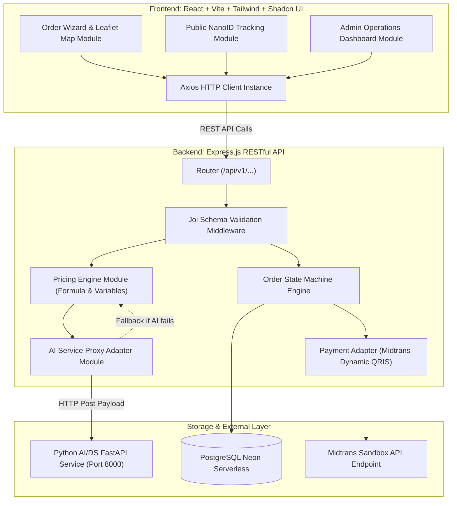

# System & Visual Design Document (`design.md`)
## Proyek: Platform Pemesanan & Operasional Terpusat UMKM disuruhsuruh (Samarinda)

- **File Path:** `design.md`
- **Acuan Utama:** [`prd.md`](./prd.md)
- **Standar Desain:** `antislop-ui` & `codebase-design`
- **Arsitektur:** Decoupled Full-Stack (React 18 + Vite + Tailwind CSS + Shadcn UI di Frontend; Express.js + Joi + PostgreSQL Neon di Backend)
- **Status:** Master Technical & Visual Specification

---

## 1. Design Philosophy & Visual Direction

### 1.1 Prinsip Desain Anti-Slop
1. **Bukan Template AI Generik:** Tidak ada latar belakang ungu-biru neon (*dark neon glowing blobs*), tidak ada glassmorphism berlebihan, dan tidak ada emoji dekoratif pada teks antarmuka.
2. **Desktop Elegance with Seamless Mobile Reflow:** Tampilan awal di layar desktop dirancang luas, berjarak lega (*spacious*), berkarakter premium, dan memiliki hierarki visual yang memanjakan mata, yang secara mulus bertransformasi menjadi antarmuka ramah jempol (*thumb-friendly*) saat diakses melalui ponsel.
3. **Subtle Motion & Depth (Parallax):** Animasi dan efek paralaks digunakan secara terukur (*dose-capped*) untuk memberikan kedalaman (*depth*) dan ritme visual saat halaman digulir, bukan animasi berulang tanpa henti (*perpetual loops*).
4. **Kontras Tinggi & Keterbacaan Nyata:** Memenuhi standar aksesibilitas WCAG AA (rasio kontras minimal 4.5:1 untuk teks normal dan 3:1 untuk elemen UI).

---

## 2. Design System & Tokens

### 2.1 Palet Warna (Color Palette)

| Token Name | Hex Code | Tailwind Equivalent | Peran / Penggunaan |
| :--- | :--- | :--- | :--- |
| `--color-bg-marketing` | `#FAF7F2` | warm cream | Kanvas landing page dan area brand yang hangat. |
| `--color-bg-base` | `#F8FAFC` | `slate-50` | Latar belakang aplikasi dan halaman operasional yang bersih. |
| `--color-surface` | `#FFFFFF` | `white` | Kartu konten, kontainer formulir, dan bilah navigasi. |
| `--color-surface-subtle` | `#F1F5F9` | `slate-100` | Latar belakang field input sekunder, tab yang tidak aktif, dan chip. |
| `--color-border` | `#E2E8F0` | `slate-200` | Garis batas tipis 1px pada kartu dan tabel untuk definisi bidang yang tegas. |
| `--color-text-main` | `#0F172A` | `slate-900` | Teks judul dan isi utama (kontras tinggi, keterbacaan tajam). |
| `--color-text-muted` | `#64748B` | `slate-500` | Teks keterangan pendukung, label input, dan timestamp. |
| `--color-primary` | `#EA580C` | `orange-600` | Tombol aksi utama (*Pesan Sekarang, Bayar*), warna brand disuruhsuruh. |
| `--color-primary-hover` | `#C2410C` | `orange-700` | State hover pada tombol aksi utama. |
| `--color-primary-subtle`| `#FFEDD5` | `orange-100` | Badge aktif, highlight harga rincian, dan aksen latar lembut. |
| `--color-success` | `#047857` | `emerald-700` | Tombol WhatsApp resmi, status LUNAS, dan konfirmasi pesanan berhasil. |
| `--color-warning` | `#D97706` | `amber-600` | Status PENDING / Menunggu Konfirmasi, timer countdown 15 menit. |
| `--color-danger` | `#DC2626` | `red-600` | Pembatalan pesanan, status barang kosong, dan peringatan di luar radius. |

### 2.2 Tipografi (Typography)
* **Font Family:** `Plus Jakarta Sans`, sans-serif (Google Fonts). Karakter geometris modern dengan *legibility* tinggi.
* **Skala Tipografi:**
  - `Hero Display (Desktop)`: `text-5xl font-extrabold tracking-tight` (48px / line-height 1.15)
  - `Section Heading (H2)`: `text-3xl font-bold tracking-tight` (30px / line-height 1.25)
  - `Card Title (H3)`: `text-xl font-semibold` (20px / line-height 1.35)
  - `Body Normal`: `text-base font-normal` (16px / line-height 1.5)
  - `Body Small / Captions`: `text-sm font-medium` (14px / line-height 1.4)
  - `Micro Label`: `text-xs font-semibold tracking-wider uppercase` (12px)

### 2.3 Sistem Elevasi & Bayangan (Elevation & Shadows)
* **Flat Base:** Elemen standar berada di level dasar dengan `border border-slate-200`.
* **Elevated Card (Hover/Active):** `shadow-sm hover:shadow-md transition-shadow duration-200`
* **Floating Bottom Sheet & Modal:** `shadow-xl border border-slate-200/80 backdrop-blur-md bg-white/95`

### 2.4 Sistem Gerak & Paralaks Terukur (Motion Dials)
* **ENERGY: 2/5** - Hangat dan ramah, tidak agresif. Oranye dipakai untuk aksi penting, bukan sebagai dekorasi di semua komponen.
* **RHYTHM: 2/5** - Pengelompokan informasi jelas, jarak antarbagian konsisten, dan variasi layout hanya ketika membantu pemahaman.
* **MOTION: 1/5** - Gerakan minimal; dipakai untuk umpan balik interaksi, progres langkah, dan parallax hero yang sangat ringan.
* **Micro-interactions:** Tombol memiliki transisi singkat `active:scale-[0.98] duration-150 ease-out`.
* **Scroll Parallax (Desktop Hero):**
  - Parallax berjalan melalui `requestAnimationFrame`, tanpa memicu render React pada setiap event scroll/mouse.
  - Dinonaktifkan pada layar kecil dan ketika `prefers-reduced-motion: reduce` aktif.
  - Tidak ada animasi pulse dekoratif yang berjalan tanpa henti.

---

## 3. UI/UX Wireframe & Screen Mockups

### 3.1 Layar 1: Landing Page (`/`)

#### Tampilan Desktop (Wide Canvas, Spacious & Dynamic):
```text
┌────────────────────────────────────────────────────────────────────────────────────────┐
│ [disuruhsuruh.id]                  Layanan   Tarif Transparan   Tentang    [Lacak Resi] │
├────────────────────────────────────────────────────────────────────────────────────────┤
│                                                                                        │
│   Samarinda: 07.30 - 22.00 WITA                                                        │
│                                                                                        │
│   Jasa Antar Barang, Titip Belanja,          ┌──────────────────────────────────────┐  │
│   dan Bersih Rumah di Samarinda              │  [SIMULASI RUTE LIVE - PETA SAMARINDA│  │
│                                              │  Titik A: Kampus UNMUL Gunung Kelua  │  │
│   Kalkulasi tarif jalan raya transparan,     │  Titik B: Samarinda Seberang         │  │
│   rute peta akurat, tanpa biaya tersembunyi. │  ──────────────────────────────────  │  │
│   Pesan langsung tanpa wajib registrasi akun.│  Jarak Rute: 7.4 km                  │  │
│                                              │  Estimasi Tarif : Rp 24.500          │  │
│   ┌────────────────────────┐                 │  Estimasi Waktu : ~22 Menit (AI)     │  │
│   │  Pesan Layanan Cepat   │                 └──────────────────────────────────────┘  │
│   └────────────────────────┘                  (Parallax Floating Component on Scroll)  │
│                                                                                        │
├────────────────────────────────────────────────────────────────────────────────────────┤
│  LAYANAN UTAMA KAMI (Tiga Layanan Dinamis)                                             │
│                                                                                        │
│  ┌─────────────────────────┐ ┌─────────────────────────┐ ┌──────────────────────────┐ │
│  │ 🛵 ANTAR BARANG / KURIR │ │ 🛒 TITIP BELI / JASTIP  │ │ 🧹 BERSIH RUMAH & KOS     │ │
│  │ Kirim dokumen, makanan, │ │ Belanja ke minimarket,  │ │ Bersih kamar kos, rumah,  │ │
│  │ laundry, dan perabot.   │ │ apotek, atau pasar.     │ │ kantor. Dihitung adil     │ │
│  │ Dihitung akurat sesuai  │ │ Talangan aman dengan    │ │ dari basecamp. Opsi mitra │ │
│  │ rute jalan raya.        │ │ struk kasir asli toko.  │ │ pria atau wanita.         │ │
│  │ [Hitung Ongkir ➔]       │ │ [Titip Belanja ➔]       │ │ [Pesan Bersih ➔]          │ │
│  └─────────────────────────┘ └─────────────────────────┘ └──────────────────────────┘ │
│                                                                                        │
├────────────────────────────────────────────────────────────────────────────────────────┤
│  STANDAR OPERASIONAL & KEPERCAYAAN                                                     │
│  • Radius Samarinda 25 KM  • Struk Belanja Asli  • Refund 100% Jika Stok Habis         │
│  • Hubungi Kami: WhatsApp Resmi 0853-3245-5999 • Kantor: Samarinda, Kalimantan Timur   │
└────────────────────────────────────────────────────────────────────────────────────────┘
```

#### Adaptasi Layar Mobile:
* Grid 3 kolom otomatis berubah menjadi kartu tumpuk vertikal (*stack layout*).
* Komponen simulasi rute desktop diringkas menjadi kartu sorotan ringkas.
* Muncul **Sticky Bottom Bar** di bagian paling bawah layar HP:
  `[ Pesan Sekarang ➔ (Mulai dari Rp 8.000) ]` yang selalu berada dalam jangkauan jempol.

---

### 3.2 Layar 2: Formulir Pemesanan Dinamis (`/order`)

Pemesanan menggunakan **progressive wizard tiga langkah** agar pelanggan tidak langsung dihadapkan pada seluruh formulir.

1. **Pilih layanan:** Antar Barang, Titip Beli, atau Bersih-bersih.
2. **Tentukan lokasi:** peta Leaflet dan input alamat. Untuk layanan Bersih-bersih, titik awal dikunci pada basecamp.
3. **Rincian dan konfirmasi:** field dinamis sesuai layanan, identitas pelanggan, metode pembayaran, dan rincian estimasi tarif.

Peta berada pada langkah tersendiri, bukan split view permanen. Keputusan ini menjaga fokus pelanggan dan lebih mudah direflow pada layar ponsel. Data dari langkah sebelumnya tetap dipertahankan ketika pengguna kembali.

**Aturan lokasi:** alamat teks tidak melakukan geocoding otomatis. Jika teks alamat diubah, titik koordinat terkait harus dipilih ulang pada peta. Jarak preview boleh memakai rute browser, tetapi backend menghitung ulang jarak sebelum pesanan disimpan dan harga transaksi ditetapkan.

**Aturan harga:** estimasi bukan harga final. Harga final dikonfirmasi admin sebelum pembayaran. COD dibatasi maksimal Rp50.000 sesuai aturan bisnis saat ini. AI saat ini hanya dipakai untuk prediksi durasi; nilai harga tetap dihitung oleh pricing engine deterministik, bukan output AI.

**Motion:** perpindahan langkah menggunakan transisi singkat; tidak ada animasi yang menghambat input atau konfirmasi.

---

### 3.3 Layar 3: Pelacakan Resi Publik (`/track/:nanoId`)

Tidak memerlukan login akun. Tautan dibuat acak dan aman (contoh: `/track/ds_9xK2mP1q`).

```text
┌────────────────────────────────────────────────────────────────────────────────────────┐
│ disuruhsuruh.id                                                     Bantuan: [Chat WA] │
├────────────────────────────────────────────────────────────────────────────────────────┤
│ PESANAN #DS-9XK2MP1Q                                   Waktu Pesan: 29 Okt 2026, 14:10 │
│ Pelanggan: Ahmad F**** (0812****4321)                  Layanan    : Antar Barang Kurir │
├────────────────────────────────────────────────────────────────────────────────────────┤
│ STATUS PROGRESS PESANAN                                                                │
│                                                                                        │
│   (✓) PESANAN DIBUAT       Selesai - 14:10 WITA                                        │
│    │                                                                                   │
│   (✓) DIKONFIRMASI ADMIN   Harga disetujui Rp 18.400. Mitra: Budi Santoso (0852xxxx)   │
│    │                                                                                   │
│   (●) MENUNGGU PEMBAYARAN  Selesaikan pembayaran QRIS dalam: 13:45 Menit [COUNTDOWN]   │
│    │                       ┌────────────────────────────────────────────────────────┐  │
│    │                       │  [KODE QRIS DINAMIS - MIDTRANS SANDBOX]                │  │
│    │                       │  Scan via GoPay / BCA / Mandiri / ShopeePay / DANA     │  │
│    │                       │  Total Tagihan: Rp 18.400 [Salin Nominal]              │  │
│    │                       └────────────────────────────────────────────────────────┘  │
│    │                                                                                   │
│   ( ) MITRA MENUJU LOKASI  Mitra segera meluncur setelah pembayaran terverifikasi      │
│    │                                                                                   │
│   ( ) SELESAI              Bukti foto pengerjaan & Struk digital                       │
├────────────────────────────────────────────────────────────────────────────────────────┤
│ BUTUH BANTUAN DARURAT?                                                                 │
│ [ 💬 Hubungi Admin via WhatsApp (ID Pesanan Terlampir) ]     [ Batalkan Pesanan ]      │
└────────────────────────────────────────────────────────────────────────────────────────┘
```

---

### 3.4 Layar 4: Dasbor Operasional Admin (`/admin/dashboard`)

```text
┌────────────────────────────────────────────────────────────────────────────────────────┐
│ DISURUHSURUH ADMIN DASHBOARD                   Status: 🟢 BUKA  |  Admin: Kak Gani (v) │
├────────────────────────────┬────────────────────────────┬──────────────────────────────┤
│ PESANAN HARI INI           │ PERLU KONFIRMASI (PENDING) │ OMSET HARI INI               │
│ 38 Pesanan                 │ 3 Pesanan                  │ Rp 742.000                   │
├────────────────────────────┴────────────────────────────┴──────────────────────────────┤
│ DAFTAR PESANAN MASUK [Semua] [Pending (3)] [Diproses (8)] [Selesai (27)] [Ekspor CSV]  │
├──────────────┬──────────────┬──────────┬──────────┬───────────┬────────────┬───────────────┤
│ ID ORDER     │ PELANGGAN    │ LAYANAN  │ JARAK/QTY│ TARIF     │ STATUS     │ AKSI CEPAT    │
├──────────────┼──────────────┼──────────┼──────────┼───────────┼────────────┼───────────────┤
│ #DS-9xK2mP1q │ Ahmad F.     │ Antar    │ 4.8 km   │ Rp 18.400 │ PENDING    │ [Tinjau & ACC]│
│ #DS-3mB8tL5w │ Siti Nurhal. │ Bersih   │ 3 Jam    │ Rp 95.000 │ DIPROSES   │ [Tugaskan Mtr]│
│ #DS-1aZ9qK0r │ Kevin M.     │ Titip    │ 2 Toko   │ Rp 34.000 │ BUTUH_RFND │ [Transfer RFD]│
└──────────────┴──────────────┴──────────┴──────────┴───────────┴────────────┴───────────────┘
```

---

## 4. Technical Architecture & Modular Seams (`codebase-design`)



### Seam Boundaries (Prinsip Deep Modules):
1. **Seam `PricingEngine`**: Menerima parameter jarak, jenis layanan, dan variabel bebas. Bertanggung jawab menghitung komponen harga transparan. Tidak peduli apakah dipanggil dari form web atau proses batch admin.
2. **Seam `AIProxyAdapter`**: Membungkus panggilan ke model machine learning Python. Memiliki *circuit-breaker* internal: jika koneksi AI *timeout* > 3000ms, fungsi otomatis mengeksekusi kalkulasi heuristik cadangan (*fallback*) tanpa menimbulkan uncaught exception.
3. **Seam `OrderStateMachine`**: Mengatur transisi status yang sah (`PENDING` $\rightarrow$ `CONFIRMED` $\rightarrow$ `IN_PROGRESS` $\rightarrow$ `COMPLETED` / `CANCELLED`). Mencegah mutasi data ilegal.

---

## 5. Database Schema DDL (PostgreSQL Neon)

```sql
-- Enums untuk konsistensi tipe data
CREATE TYPE service_category AS ENUM ('antar_barang', 'titip_beli', 'bersih_rumah');
CREATE TYPE order_status AS ENUM (
    'PENDING_REVIEW', 
    'AWAITING_PAYMENT',
    'CONFIRMED',
    'EXPIRED',
    'PAYMENT_CONFIRMED', 
    'MITRA_ASSIGNED', 
    'IN_PROGRESS', 
    'COMPLETED', 
    'CANCELLED_BY_USER', 
    'CANCELLED_BY_ADMIN', 
    'REFUND_REQUESTED', 
    'REFUNDED'
);
CREATE TYPE payment_method_type AS ENUM ('COD', 'QRIS_DIGITAL');
CREATE TYPE payment_status_type AS ENUM ('UNPAID', 'PAID', 'REFUNDED');

-- 1. Tabel Katalog Layanan
CREATE TABLE services (
    id SERIAL PRIMARY KEY,
    category service_category NOT NULL UNIQUE,
    title VARCHAR(100) NOT NULL,
    base_fare NUMERIC(10, 2) NOT NULL DEFAULT 8000.00,
    base_distance_km NUMERIC(5, 2) NOT NULL DEFAULT 2.00,
    per_km_rate NUMERIC(10, 2) NOT NULL DEFAULT 3000.00,
    hourly_rate NUMERIC(10, 2) DEFAULT 30000.00,
    is_active BOOLEAN NOT NULL DEFAULT TRUE,
    created_at TIMESTAMP WITH TIME ZONE DEFAULT CURRENT_TIMESTAMP,
    updated_at TIMESTAMP WITH TIME ZONE DEFAULT CURRENT_TIMESTAMP
);

-- 2. Tabel Pesanan (Orders Core)
CREATE TABLE orders (
    id UUID PRIMARY KEY DEFAULT gen_random_uuid(),
    nano_id VARCHAR(16) NOT NULL UNIQUE,
    service_type service_category NOT NULL,
    customer_name VARCHAR(100) NOT NULL,
    customer_phone VARCHAR(20) NOT NULL,
    
    -- Lokasi & Jarak
    pickup_address TEXT,
    dropoff_address TEXT NOT NULL,
    pickup_lat DOUBLE PRECISION,
    pickup_lng DOUBLE PRECISION,
    dropoff_lat DOUBLE PRECISION NOT NULL,
    dropoff_lng DOUBLE PRECISION NOT NULL,
    distance_km NUMERIC(6, 2) NOT NULL DEFAULT 0.00,
    
    -- Variabel Bebas & Rincian Barang/Kosan
    dynamic_payload JSONB NOT NULL DEFAULT '{}'::jsonb,
    
    -- Kalkulasi & Penyesuaian Harga
    initial_estimated_price NUMERIC(10, 2) NOT NULL,
    final_price NUMERIC(10, 2) NOT NULL,
    price_override_reason TEXT,
    predicted_duration_minutes INT DEFAULT 20,
    
    -- Pembayaran
    payment_method payment_method_type NOT NULL DEFAULT 'COD',
    payment_status payment_status_type NOT NULL DEFAULT 'UNPAID',
    payment_expiry_at TIMESTAMP WITH TIME ZONE,
    payment_transaction_id VARCHAR(100),
    qris_qr_url TEXT,
    
    -- Status & Penugasan
    status order_status NOT NULL DEFAULT 'PENDING_REVIEW',
    assigned_mitra_name VARCHAR(100),
    assigned_mitra_phone VARCHAR(20),
    
    -- Bukti Pengerjaan
    proof_image_url TEXT,
    admin_notes TEXT,
    
    created_at TIMESTAMP WITH TIME ZONE DEFAULT CURRENT_TIMESTAMP,
    updated_at TIMESTAMP WITH TIME ZONE DEFAULT CURRENT_TIMESTAMP
);

CREATE INDEX idx_orders_nano_id ON orders(nano_id);
CREATE INDEX idx_orders_status ON orders(status);
CREATE INDEX idx_orders_created_at ON orders(created_at DESC);

-- 3. Tabel Log Inferensi AI (Untuk Evaluasi Data Science)
CREATE TABLE ai_inference_logs (
    id SERIAL PRIMARY KEY,
    order_id UUID REFERENCES orders(id) ON DELETE SET NULL,
    model_name VARCHAR(50) NOT NULL,
    input_features JSONB NOT NULL,
    predicted_output NUMERIC(10, 2) NOT NULL,
    is_fallback BOOLEAN NOT NULL DEFAULT FALSE,
    latency_ms INT NOT NULL,
    created_at TIMESTAMP WITH TIME ZONE DEFAULT CURRENT_TIMESTAMP
);

-- 4. Tabel Pengembalian Dana (Refunds)
CREATE TABLE refunds (
    id UUID PRIMARY KEY DEFAULT gen_random_uuid(),
    order_id UUID NOT NULL REFERENCES orders(id) ON DELETE CASCADE,
    bank_name VARCHAR(50) NOT NULL,
    account_number TEXT NOT NULL,
    account_holder_name TEXT NOT NULL,
    refund_amount NUMERIC(10, 2) NOT NULL,
    reason TEXT NOT NULL DEFAULT 'Barang kosong di toko',
    is_completed BOOLEAN NOT NULL DEFAULT FALSE,
    transfer_receipt_url TEXT,
    processed_by VARCHAR(50),
    created_at TIMESTAMP WITH TIME ZONE DEFAULT CURRENT_TIMESTAMP,
    completed_at TIMESTAMP WITH TIME ZONE
);

-- 5. Tabel Daftar Hitam Nomor / IP (Anti-Spam)
CREATE TABLE blacklist_contacts (
    id SERIAL PRIMARY KEY,
    phone_number VARCHAR(20) UNIQUE,
    ip_address VARCHAR(45),
    reason TEXT NOT NULL,
    created_at TIMESTAMP WITH TIME ZONE DEFAULT CURRENT_TIMESTAMP
);
```

---

## 6. RESTful API Contracts (`/api/v1/...`)

### 6.1 `POST /api/v1/pricing/estimate`
Menghitung estimasi rincian tarif sebelum pelanggan mengirimkan pesanan.
* **Request Body:**
```json
{
  "service_type": "antar_barang",
  "distance_km": 4.8,
  "pickup_coords": { "lat": -0.4948, "lng": 117.1492 },
  "dropoff_coords": { "lat": -0.5021, "lng": 117.1537 },
  "item_weight_kg": 3,
  "item_dimension": "sedang"
}
```
* **Success Response (200 OK):**
```json
{
  "status": "success",
  "data": {
    "base_fare": 8000,
    "distance_fare": 8400,
    "variable_fare": 2000,
    "total_estimated_price": 18400,
    "predicted_duration_minutes": 18,
    "is_ai_fallback": false,
    "breakdown": [
      { "label": "Tarif Dasar (2 km pertama)", "amount": 8000 },
      { "label": "Jarak Tambahan (2.8 km x Rp3.000)", "amount": 8400 },
      { "label": "Handling Beban Sedang", "amount": 2000 }
    ]
  }
}
```

### 6.2 `POST /api/v1/orders`
Mendaftarkan pesanan baru dari formulir pelanggan.
* **Request Body (Divalidasi Joi):**
```json
{
  "service_type": "titip_beli",
  "customer_name": "Ahmad Faris",
  "customer_phone": "081254329876",
  "dropoff_address": "Jl. Pramuka 5B No. 12, Samarinda",
  "dropoff_coords": { "lat": -0.4721, "lng": 117.1611 },
  "pickup_address": "Pasar Segiri Samarinda",
  "pickup_coords": { "lat": -0.4902, "lng": 117.1422 },
  "distance_km": 3.2,
  "payment_method": "QRIS_DIGITAL",
  "dynamic_payload": {
    "shopping_list": "1 kg Telur, 1 liter Minyak Goreng, Sayur Bayam",
    "estimated_items_cost": 45000,
    "out_of_stock_preference": "call_customer",
    "is_traditional_market": true
  }
}
```
* **Success Response (201 Created):**
```json
{
  "status": "success",
  "message": "Pesanan berhasil dibuat",
  "data": {
    "nano_id": "ds_9xK2mP1q",
    "tracking_url": "/track/ds_9xK2mP1q",
    "status": "PENDING_REVIEW",
    "estimated_price": 63000
  }
}
```

### 6.3 `GET /api/v1/orders/:nanoId`
Mengambil data pelacakan publik pelanggan. Data nomor HP disamarkan.
* **Success Response (200 OK):**
```json
{
  "status": "success",
  "data": {
    "nano_id": "ds_9xK2mP1q",
    "service_type": "titip_beli",
    "customer_name": "Ahmad F.",
    "customer_phone_masked": "0812****9876",
    "dropoff_address": "Jl. Pramuka 5B No. 12, Samarinda",
    "status": "AWAITING_PAYMENT",
    "final_price": 63000,
    "payment_method": "QRIS_DIGITAL",
    "qris_qr_url": "https://api.sandbox.midtrans.com/v2/qris/123/qr-code",
    "payment_expiry_at": "2026-10-29T14:25:00.000Z",
    "assigned_mitra": {
      "name": "Budi Santoso",
      "phone": "0852****2233"
    },
    "whatsapp_smart_link": "https://wa.me/6285332455999?text=Halo%20Admin%20disuruhsuruh,%20saya%20konfirmasi%20order%20DS-9xK2mP1q"
  }
}
```

### 6.4 `PATCH /api/v1/admin/orders/:id/approve`
Admin menyetujui pesanan, menetapkan harga final, dan menugaskan mitra kurir.
* **Request Body:**
```json
{
  "final_price": 63000,
  "price_override_reason": "Sesuai kalkulasi standar",
  "assigned_mitra_name": "Budi Santoso",
  "assigned_mitra_phone": "085233112233"
}
```
* **Success Response (200 OK):** Memicu pembuatan QRIS Dinamis jika metode `QRIS_DIGITAL`, dan mengubah status menjadi `AWAITING_PAYMENT` (atau langsung `MITRA_ASSIGNED` jika `COD`).

---

Dokumen `design.md` adalah acuan arah visual dan teknis. Status implementasi aktual harus selalu dicocokkan dengan kode, pengujian, dan catatan audit; keberadaan spesifikasi tidak otomatis berarti fitur telah selesai.


## 4. Keputusan Implementasi dan State

### 4.1 Status pesanan dan status pembayaran adalah dua domain terpisah

Status pesanan: `PENDING_REVIEW`, `AWAITING_PAYMENT`, `CONFIRMED`, `EXPIRED`, `PAYMENT_CONFIRMED` (legacy), `MITRA_ASSIGNED`, `IN_PROGRESS`, `COMPLETED`, `CANCELLED_BY_USER`, `CANCELLED_BY_ADMIN`, `REFUND_REQUESTED`, `REFUNDED`.

Status pembayaran: `UNPAID`, `PAID`, `REFUNDED`.

Untuk pesanan QRIS, pesanan tidak dapat masuk tahap konfirmasi/penugasan sebelum notifikasi pembayaran terverifikasi. Pesanan COD dapat diproses tanpa menandai pembayaran sebagai lunas.

### 4.2 Refund

Pengajuan refund otomatis hanya tersedia untuk pesanan Titip Beli yang sudah dibayar dan masih berada pada status operasional yang memenuhi syarat. Pengajuan diverifikasi admin; UI tidak menjanjikan transfer instan.

### 4.3 Fitur yang belum menjadi kontrol operasional

Toggle buka/tutup layanan dan rating pelanggan tidak ditampilkan sebagai kontrol aktif sampai tersedia penyimpanan backend dan alur administrasi yang sebenarnya. Tidak boleh menyimpan kesan bahwa data hanya tersimpan lokal sudah terkirim ke UMKM.
